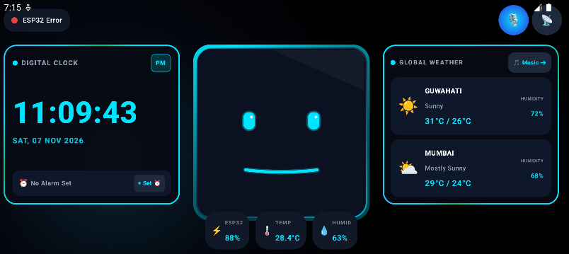

# F.R.I.D.A.Y Table Clock Bot 🤖⚡
> **Futuristic Android Companion App & ESP32 Smart Robot Ecosystem**


---

## ✨ Features Overview

### 🤖 Expressive Robot Face & Visual Animations
* **5 Expression Modes**: `NORMAL` (Neon Cyan), `SMILING` (Emerald Green), `CRYING` (Royal Blue), `SHIVERING` (Ice Blue), and `ANGRY` (Crimson Red).
* **Lip-Sync Audio Morphing**: Anime-style mouth morphing synchronized with Friday's TTS voice output.
* **Music Studio Headphones**: Robot wears glowing neon headphones and closes eyes (`^ ^`) when listening to music.
* **100% Harmonious Theme Sync**: All HUD boxes (`Digital Clock`, `Global Weather`, `Music Player`, `Environment Pills`, `Background Glow`) update their revolving liquid-flow borders and text in **100% unison** with the active expression mode (pure crimson/white flow in Angry mode, pure emerald/white in Smile mode, etc.).

### 🎵 Cyberpunk Music Player HUD & YouTube Music Sync
* **Live System & YouTube Music Sync**: Automatically hooks into active playback (YouTube Music, Spotify, Apple Music, Wynk, Local Audio).
* **Live Album Cover Photo**: Displays real-time album cover artwork directly inside Friday's Music HUD.
* **Touch-Interactive Seek Bar (`Slider`)**: Touch or drag anywhere along the seek bar slider to jump audio playback to that exact timestamp (`seekTo`).
* **Real-Time Scrolling Lyrics**: Synchronized lyrics box scrolling in real-time with track position.
* **Color-Coded Hardware Media Controls**: Crimson Red **`⏮ Previous`**, Mode Accent **`⏯ Play/Pause`**, and Emerald Green **`⏭ Next`** buttons.
* **Offline Protection UI**: Displays `🌐 Internet Offline` when disconnected, hiding online stream data.

### ⏰ Digital Clock, System Alarm, Stopwatch & Countdown Timer
* **Ultra-Huge 50sp Time Digits**: Massive extra-bold time numbers filling the portrait card space.
* **Header AM/PM Badge**: AM/PM indicator placed in a glowing pill badge in the header.
* **Live Mobile System Alarm Sync**: Queries Android `AlarmManager.nextAlarmClock` (`⏰ Alarm: 07:30 AM`) & system status bar alarm icon (`⏰`). Includes 1-tap alarm creator (`TimePickerDialog`).
* **⏱ Stopwatch Mode**: Real-time centisecond timer (`00:00.00`) with Start/Pause & Reset controls.
* **⌛ Countdown Timer Mode**: Preset duration chips (`1m`, `3m`, `5m`, `10m`), live countdown (`03:00` $\rightarrow$ `00:00`), and glowing red Alarm Pop-Up Dialog (**`⏰ TIMER FINISHED!`**) when reaching zero.

### 🎙 Friday Voice Assistant & Hardware Spec Analysis
* **"Friday, Greet Yourself!"**: Friday queries real mobile hardware specs (Manufacturer, Model, CPU Cores, Total RAM, Free RAM, Total Storage, Free Storage, Android Version) and speaks her self-introduction out loud.
* **Voice Expression Switching**: *"Friday, turn into happy mode"*, *"turn into angry mode"*, *"turn into cold mode"*, etc.
* **Voice Music Search & Play**: Say *"Friday, play Bawra"* or *"play Kesariya on YouTube Music"*, and Friday searches and starts playing that song directly on YouTube Music!
* **Hands-Free Queries & Commands**: ESP32 Temperature, Humidity, Battery, Weather, Clock, Alarm, Stopwatch, and Timer voice commands.
* **Self-Listening Prevention**: Speech recognition automatically pauses while Friday speaks TTS output so she never loops her own voice.

### 📱 Live Top Bar Status & 10% Battery Depletion Warnings
* **Live Status Indicators**:
  * `[ ESP32 Connected / Offline ]` (Green / Gray dot)
  * `[ Internet Online / Offline ]` (Green / Red dot)
  * `[ 🔋 Phone Battery % & Charging ]` (`🔋 78%` / `⚡ 85% Charging`)
* **10% Battery Depletion Voice Warnings**: Below 50% battery, Friday warns out loud every 10% depletion step (*"Warning! Mobile phone battery depleted to 38%. Please plug in your charger."*).

### 🎭 Top-Right `MODES` Assistant Panel & Mic Toggle
* **Action Button Order**: `[ 🎭 MODES ]` $\rightarrow$ `[ 🎙 MIC OFF / LISTENING ]` $\rightarrow$ `[ 📡 SETTINGS ]`.
* **`🎭 MODES` Panel**: Dedicated dialog panel with 1-tap options for all expression modes, assistant queries, alarm, stopwatch, timer, and music controls.
* **`🎙 MIC OFF / LISTENING`**: Interactive mic toggle button for continuous background speech recognition.

### 🔕 Distraction-Free Priority DND Mode
* **Notification Suppression**: Auto-enables Priority Do Not Disturb (DND) mode while running, keeping notification popups and sounds hidden. Restores original settings upon exit.
### 🔕 Distraction-Free DND Mode
* **Notification Suppression**: Automatically enables Priority Do Not Disturb (DND) mode while the app is active, keeping notification popups and sounds hidden. Restores original settings when exiting.


### ⛅ Global Weather HUD
* **OpenWeatherMap Integration**: Displays live temperatures, weather conditions, high/low range, and humidity for dual cities (e.g. Guwahati & Mumbai).


### 🌐 Triple Connection Engine (ESP32)
* **📶 BLE GATT Server**: Direct Bluetooth Low Energy communication via Service UUID `0000FFE0-0000-1000-8000-00805F9B34FB`.
* **🔌 USB OTG Serial**: Direct wired serial communication at 115200 Baud using Android USB Host API.
* **📡 Wi-Fi AP & mDNS**: Connects to ESP32 Access Point (`192.168.4.1`) or mDNS hostname (`friday-bot.local`).
## 💻 Software & ESP32 Code

### ESP32 Firmware (`AI_Bot_ESP32_DHT22.ino`)
The firmware handles dual-mode communication over **USB Serial (115200 Baud)** and **Wi-Fi WebServer (Port 80)**.

#### Flash the ESP32:
1. Open [`D:\AI bot Ino\AI_Bot_ESP32_DHT22\AI_Bot_ESP32_DHT22.ino`](D:/AI%20bot%20Ino/AI_Bot_ESP32_DHT22/AI_Bot_ESP32_DHT22.ino) in **Arduino IDE**.
2. Install the **DHT sensor library** (`DHT.h`).
3. Select Board: **ESP32 Dev Module** and Upload.

> 💡 **Tip**: If using the blue **DHT11** sensor instead of white DHT22, change `#define DHT_TYPE DHT22` to `#define DHT_TYPE DHT11` at line 28 of the `.ino` sketch.

---

## 🛠️ Project Architecture

```
AI_BOT20/
├── app/src/main/
│   ├── java/com/example/ai_bot20/
│   │   └── MainActivity.kt        # Main Compose UI, ViewModels, System Media Sync & Voice Assistant
│   └── AndroidManifest.xml        # DND, Audio, Bluetooth, USB, Alarm & Notification Listener Permissions
├── firmware/
│   └── AI_Bot_ESP32_DHT22.ino     # ESP32 C++ Sketch (BLE GATT, USB OTG, Wi-Fi AP, DHT11/22)
├── build.gradle.kts
└── settings.gradle.kts
```

---

## 🔌 Hardware Wiring Guide (ESP32 & DHT22/DHT11)

| ESP32 Pin | Component Pin | Description |
| :--- | :--- | :--- |
| **3V3 / 5V** | VCC | Sensor Power |
| **GND** | GND | Sensor Ground |
| **GPIO 4** | DATA / OUT | DHT22 Temperature & Humidity Data Pin |

---


## 🚀 Getting Started & Installation

### Prerequisites
* **Android Studio**: Jellyfish / Koala or newer
* **Android Device**: Android 8.0 (API 26) or higher
* **ESP32 Board**: ESP32 Dev Module (WROOM-32)
* **Arduino IDE**: 2.0+ with ESP32 board package installed

### 1. ESP32 Firmware Setup
1. Open `firmware/AI_Bot_ESP32_DHT22.ino` in Arduino IDE.
2. Install libraries: `DHT sensor library`, `Adafruit Unified Sensor`.
3. Select board: **ESP32 Dev Module**.
4. Upload firmware to ESP32 via USB.

### 2. Android App Build
1. Clone this repository:
   ```bash
   git clone https://github.com/your-username/AI_BOT2.0.git
   ```
2. Open the project in **Android Studio**.
3. Build and assemble Debug APK:
   ```bash
   ./gradlew :app:assembleDebug
   ```
4. Deploy to your Android device.

---

## 📲 Permissions Required




* `ACCESS_NOTIFICATION_POLICY`: Auto-enables Distraction-Free DND mode.
* `BIND_NOTIFICATION_LISTENER_SERVICE`: Real-time YouTube Music / Spotify track & album art sync.
* `SCHEDULE_EXACT_ALARM` & `SET_ALARM`: System Alarm Clock scheduling.
* `BLUETOOTH_SCAN` & `BLUETOOTH_CONNECT`: BLE scanning and GATT connection.
* `RECORD_AUDIO`: Friday voice assistant speech recognition.
* `READ_MEDIA_AUDIO` / `READ_EXTERNAL_STORAGE`: Local music file playback.

---

## 📄 License
This project is licensed under the MIT License - see the [LICENSE](LICENSE) file for details.

